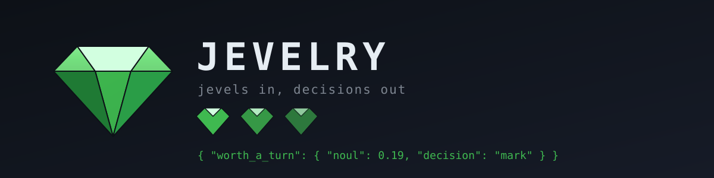

<p align="center">
  <a href="#overview">Overview</a> ·
  <a href="#installation">Install</a> ·
  <a href="#usage">Usage</a> ·
  <a href="#command-line-reference">Commands</a> ·
  <a href="#keyboard-shortcuts">Keys</a> ·
  <a href="#jevels">Jevels</a> ·
  <a href="#local-models">Local models</a> ·
  <a href="#configuration">Configuration</a> ·
  <a href="https://docs.typesafe.ai">Jev docs</a>
</p>

<p align="center">
  
  
  
  
</p>

<p align="center"><b>Use Jev everywhere to make &amp; track decisions.</b></p>

<p align="center"></p>

> [!WARNING]
> **Early development:** jevelry is young and changes fast. Commands, the jevel format and the answer document may change between minor versions until 1.0, so pin the version you depend on.

jevelry lets your code and your coding agent ask Jev, the decision model from TypeSafe, a small typed question and get back a decision it can act on, and it keeps every decision so you can see how often Jev was right. It asks hosted Jev with a TypeSafe key, or a Jev-compatible decision model that runs on your own machine.

## Overview

Your code and your coding agent make the same small calls every day: is this ticket urgent, which team should get it, is this bug a duplicate, did this test fail because of the code or because of the machine it ran on. Today each of those is usually a prompt that returns text you parse, and you don't learn how sure the model was.

With jevelry you ask each of those questions to Jev with one command. A question lives in a small file called a jevel, and seventeen ready-made jevels ship with the package. Jev answers with how sure it is, and the jevel turns that into one of three decisions:

| Decision | Meaning | What your code does |
|---|---|---|
| `act` | Jev is sure | uses the answer |
| `mark` | Jev is fairly sure | uses the answer and flags it for a person |
| `fall_back` | Jev is unsure | does what it did before jevelry |

## Features

- **Interactive TUI**: Built with [Ink](https://github.com/vadimdemedes/ink) for a full-screen terminal experience
- **Ready-made jevels**: Seventeen decisions for tickets, messages, issues, pull requests, logs, alerts and failing tests
- **Typed decisions in code**: Load a jevel once and get a typed decision wherever your code asks
- **Commands Jev runs**: Jev picks the command to run and asks you first when it is only fairly sure
- **Review and tuning**: Mark whether Jev was right and move thresholds based on real outcomes
- **Local models**: A Jev-compatible decision model on your own machine, picked for what the machine can run, with no key and with your states staying on it
- **Persistent log**: Every decision in one local log, with a report per question
- **Tested jevels**: Every shipped jevel is checked against the real API on its own cases
- **Agent skill**: One install for Claude Code, Codex, Cursor, opencode and pi
- **Typed answers**: Your editor knows the options of every jevel

## Installation

jevelry runs on Node 22 or newer, so check `node --version` first.

### Using npm, on your machine

```sh
npm install -g jevelry
jevelry install
```

`jevelry install` puts the skill into every coding agent it finds and then asks how jevelry should reach Jev:

    How should jevelry ask Jev?
      1  TypeSafe, hosted: needs an API key
      2  A model on this machine: free and private, downloads 1 to 30 GB
    Choose 1 or 2:

With 1 it asks for your TypeSafe key, which you can skip with Enter and add later. Get a key at https://docs.typesafe.ai. With 2 it first offers a Jev server that already runs on this machine, as [Use a Jev server you already run](#use-a-jev-server-you-already-run) describes, then shows the models this machine can run and sets up the one you pick, as [Run Jev on this machine](#run-jev-on-this-machine) describes. Once jevelry asks somewhere, `install` leaves that alone and says so, and `jevelry install --typesafe` or `jevelry install --local` switches. Without a terminal, in a pipe or a CI job, it names both ways and changes nothing.

### As a library in your project

```sh
npm install jevelry
```

### In your coding agent

Run this inside Claude Code, Codex, pi, opencode or Cursor, or in your terminal:

```sh
npx jevelry install
```

If you prefer the skills installer, `npx skills add backant-io/jevelry --skill jevelry` does the same for the agents it supports.

### From source

```sh
git clone https://github.com/backant-io/jevelry.git
cd jevelry
npm install
npm run build
node bin/jevelry.js --help
```

## Usage

### Start

```sh
jevelry tui
```

It opens on the start screen with what you can do from there: try a jevel, review the decisions Jev marked, open the dashboard or go through your history. Press `d` for the dashboard, which shows you how Jev decided today, what needs you and how each of your jevels is doing. When your log is still empty, the first row on the start screen offers you a sample ticket: press enter to open it in Try and enter again to ask Jev about it live, and you see your first answer in a few seconds. Until jevelry is set up, the first row is "Set up Jev: a TypeSafe key or a model on this machine": press `s` and choose the way, and Try tells you to press `s` when you ask before that. `Set up Jev` in the command palette (`ctrl+p`) opens the same dialog later, when you want to switch.

### Ask from the command line

```sh
export TYPESAFE_API_KEY=...
npx jevelry ask ticket-triage --state '{"ticket": {"subject": "Charged twice", "message": "I was billed twice this month, please refund one today."}}'
```

You get one JSON document back with an answer per question, and the part your code reads is the decision:

    "team":        { "choice": "billing",  "confidence": 1.0,  "decision": "act"  }
    "urgent":      { "noul": 0.98,         "yes": true,        "decision": "act"  }
    "frustration": { "score": 0.24,        "confidence": 0.64, "decision": "mark" }

The whole document and a `jq` one-liner are in [docs/examples.md](docs/examples.md).

### In your program

When the decision happens inside your own code, you load the jevel once when your program starts and call `decide` at the point where your code decides today:

```ts
import { jevel } from "jevelry";

const triage = jevel("ticket-triage");

const d = await triage.decide({ ticket });
switch (d.team?.decision) {
  case "act": route(ticket, d.team.answer); break;
  case "mark": route(ticket, d.team.answer); flagForQueueOwner(ticket); break;
  case "fall_back": leaveInGeneralQueue(ticket); break;
}
```

`decide` asks Jev, writes the ask to your log and hands you every question with its `decision` and its `answer`. When Jev can't answer, because TypeSafe is busy or your network is down, every question comes back `fall_back` with the reason in `d.error`, so your code just keeps its old path. Run `npx jevelry types --out src/jevels.d.ts` once and `d.team.answer` is typed as `"billing" | "technical" | "account" | "other"`.

### Let Jev run the command

When the next step after a decision is always one of a few commands, you put those commands into the jevel and jevelry runs the one Jev picks. `failing-test` ships with the package and works this way:

```sh
npx jevelry run failing-test --dry-run --state '{"test": {"name": "checkout > pays with a saved card", "output": "TimeoutError: waiting for selector failed: timeout 5000ms exceeded", "history": "fails about once a week and passes on a rerun"}}'
```

| Decision | What happens |
|---|---|
| `act` | the command runs |
| `mark` | jevelry asks you first, and `--yes` runs it straight away |
| `fall_back` | the jevel's `fall_back` command runs |

`--dry-run` prints what would run. Your state goes to the command on stdin and in the file `JEVELRY_STATE` points at, so a ticket that says `; rm -rf ~` stays plain text. jevelry prints the path of the jevel on stderr before it runs anything, because a `jevels/` folder in your project comes before the ones that ship.

### Use it with your coding agent

You probably want your coding agent to write the jevel and wire it in, while you review the questions. Once the skill is installed, talk to your agent the way you would to a colleague who has read the guide:

    Using the jevelry skill, write a jevel that decides which team a support ticket goes to
    and whether it is urgent, run check on it, and wire the decisions into src/inbox.ts.

The skill keeps every jevel in `./jevels/` and leaves the questions and thresholds for you to read. The guide the agent reads is [skills/jevelry/references/writing-jevels.md](skills/jevelry/references/writing-jevels.md) and works for people too.

### Run Jev on this machine

jevelry can ask a Jev-compatible decision model on your own machine instead of hosted Jev. It costs nothing per ask, needs no key, and your states stay on the machine. First see what this machine can run:

```sh
jevelry models --local
```

On an Apple M4 Pro with 24 GB that prints:

    This machine: Apple M4 Pro, 24 GB memory, about 17 GB usable by the GPU
    Ranked by the Jev Decision Index 0.3.2, where hosted Jev 1.14 scores 61.5

      #  id                    model                     quant   download    needs  fit        score  s/question  licence
      1  vllm-d3-flash         vLLM-SR d3-flash 9B       Q8_0      9.6 GB  11.2 GB  runs well   55.8         2.1  Apache-2.0
      2  bespoke-nimble-9b-v3  Bespoke Nimble 9B v3      Q8_0      9.6 GB  11.2 GB  runs well   54.7         2.1  CC BY-NC 4.0, non-commercial
      3  vllm-d3-mini          vLLM-SR d3-mini 4B        Q8_0      5.2 GB   6.8 GB  runs well   52.6         1.1  Apache-2.0
      ...
     16  vllm-d3               vLLM-SR d3 27B            Q4_K_M   19.9 GB  22.6 GB  won't fit   66.3           -  Apache-2.0
     17  clef                  Cloudflare Clef 27B       Q4_K_M   20.0 GB  22.7 GB  won't fit   53.1           -  Apache-2.0
     18  openjev               OpenJev 27B               Q4_K_M   19.9 GB  22.6 GB  won't fit      -           -  CC BY-NC 4.0, non-commercial

    OpenJev 27B: not on the index; its card reports 84.0% against hosted Jev's 85.4% on its own 10,000 questions

Each row is one model at the quant that suits this machine. `download` is the size of the file, `needs` the memory it takes while it answers, `fit` whether this machine has that memory (`runs well`, `tight` or `won't fit`), `score` its result on the index, `s/question` the seconds a question of about 500 tokens takes here, and `licence` what you may use it for. Models that run well come first, then tight ones, then the ones that won't fit, each group by best score, so row 1 is the one to pick. [Local models](#local-models) says where each number comes from. `--json` prints the same rows for a program.

Then install one by its id or its row number:

```sh
jevelry install --local vllm-d3-flash
```

`jevelry install --local` with no model shows the same table and asks for a number or an id, and Enter takes row 1. `vllm-d3-flash:Q4_K_M` or `:Q8_0` forces that quant. The install then:

1. looks for llama.cpp's `llama-server` and, when it is missing or too old for the model, offers to install or upgrade it with Homebrew (`brew install llama.cpp`)
2. downloads the model from Hugging Face into `$JEVELRY_HOME/models`, resumes a download that was cut off, and checks the file against its sha256
3. starts `llama-server` with the model, asks it one setup check and says how long the answer took
4. writes `$JEVELRY_HOME/config.json`, so `ask`, `ask --batch`, `run`, `decide()` and Try ask this model from then on

A model that won't fit is refused, also with `--yes`, because a model too big for the GPU's memory can crash the machine. A tight fit and Homebrew are asked first, and `--yes` answers yes to both, which you need when there is no terminal. A failed install leaves the setup that worked before.

jevelry starts `llama-server` on `127.0.0.1` on the first ask and leaves it running for the next ones, so the first ask also waits for the model to load. After five idle minutes the server unloads the model and gives the memory back, and the next ask loads it again. `jevelry stop` stops the server and says so only once its process has exited and the memory is free, killing it after 15 seconds when it does not exit, and the next ask starts it again. jevelry never runs two models at once: an ask for another model while one runs is refused, so is a start while a server jevelry did not record runs from `$JEVELRY_HOME/models`, and switching models stops the old server and waits for it to exit before the new one loads. The answer document is the same, with the model's alias, like `local/vllm-d3-flash-Q8_0`, as its `model`, and `jevelry models` prints that alias instead of asking TypeSafe.

In `jevelry tui`, press `s` on the start screen or choose `Set up Jev` in `ctrl+p`, then `A model on this machine`. The dialog reads the models from Hugging Face and lists them in the same order, each with its download, fit, score and seconds per question. Enter on a model shows its details, its licence and whether Homebrew will install llama.cpp, and enter again installs it while the dialog shows each step and how far the download is. Once it is done, the start screen drops its setup row. `TypeSafe, hosted` tells you to run `npx jevelry install --typesafe` in a terminal or to export `TYPESAFE_API_KEY`, since the TUI does not take a key itself.

`jevelry install --typesafe` goes back to hosted Jev once there is a key, asking for one when there is none, and stops the local server. Without a key it changes nothing. The model stays on disk, so `jevelry install --local <id>` switches back without a new download.

### Use a Jev server you already run

When a Jev System One server already runs on this machine, like candle-jev's `jevd` on `127.0.0.1:8741`, jevelry can ask it instead of downloading a model, so there is one copy on disk and one model in memory:

```sh
jevelry install --local-url http://127.0.0.1:8741
```

It reads the model the server lists at `GET /v1/models` (the first one when it lists several), asks it one setup check, stops the `llama-server` jevelry runs when there is one, and writes `$JEVELRY_HOME/config.json`:

```json
{ "backend": "server", "server": { "url": "http://127.0.0.1:8741", "model": "jevk5-v0.3-mlx8" } }
```

Every ask then sends the server's own model whatever the jevel pins, and no `x-jev-lane` header, so jevd answers jevelry on its research lane, behind the program it runs for. The answer's `model` reads `local/<model>`, like `local/jevk5-v0.3-mlx8`, and Try counts it as $0. When no Jev server answers at the URL, or it fails the setup check, the install exits 1 and changes nothing.

`jevelry models --local`, `jevelry install --local` and `A model on this machine` in the TUI look for such a server first, with `GET /v1/models` on the URLs in `JEVELRY_KNOWN_SERVERS` (`http://127.0.0.1:8741` unless you set it), and offer it before any download. A server that lists only `local/` models is a `llama-server` of jevelry's own and is not offered. jevelry does not start or stop a server it did not start: `jevelry stop` says so and stops only jevelry's own `llama-server`. `jevelry install --local <id>` or `--typesafe` switches away again.

## Command-line reference

| Command | What it does |
|---|---|
| `jevelry ask [jevel]` | asks every question of a jevel (or of `--questions`) about a state and prints one JSON document; `--batch` asks many from stdin at once |
| `jevelry run <jevel>` | asks a jevel whose options name commands, then runs the command for Jev's decision |
| `jevelry outcome <log_id> <question> <value>` | records what proved true: `agree`, `disagree`, an option, a level index, `yes` or `no` |
| `jevelry report` | agreement per jevel and question, from the log |
| `jevelry tui` | the full-screen view: the start screen, the dashboard, Review, Jevel, Try and History |
| `jevelry list` | every jevel jevelry can find, with its folder; the first folder wins |
| `jevelry show <jevel>` | the resolved frontmatter as JSON, then the body, then `example.json` when the jevel has one |
| `jevelry check <jevel>` | refuses a defective jevel with exit 2 and warns about questions Jev handles poorly |
| `jevelry types` | writes a TypeScript declaration so `jevel(name).decide()` returns each jevel's own answer types |
| `jevelry models` | the model names your account may send, from `GET /v1/models`; `--local` ranks the decision models this machine can run |
| `jevelry stop` | stops the local model server jevelry started, and any it did not record, and waits until they have exited; a Jev server jevelry did not start keeps running |
| `jevelry install` | installs the skill into your coding agents, then sets up Jev: a TypeSafe key or a model on this machine |
| `jevelry install-skill` | installs the skill into your coding agents, and asks for no key |
| `jevelry help [command]` | the help of one command |

`-V, --version` prints the version and `-h, --help` prints the help, on the program and on every command. A `<source>` is `@file`, `-` for stdin, or inline JSON.

### `ask`

| Flag | What it does |
|---|---|
| `--state <source>` | the state to ask about; required without `--batch` |
| `--questions <source>` | the API's questions map, for a one-off ask with no jevel |
| `--model <id>` | the model, over the jevel's pin and `JEVELRY_MODEL` |
| `--jevels <dir>` | a jevels folder searched first; repeatable |
| `--no-log` | keeps this ask out of the log |
| `--log-state` | writes the state itself into the log line, next to its hash |
| `--batch` | reads many asks from stdin, one JSON object per line, and answers them concurrently in one process |
| `--concurrency <n>` | with `--batch`, how many asks are in flight at once; 16 by default |

With `--batch`, each stdin line is `{"id": ..., "jevel": "<name>", "state": ...}`, or `"questions"` in place of `"jevel"`, with an optional `"model"`. The `id` is a string or a number of your choosing. Each answer is one line on stdout, in the order the asks finish: the `id` followed by the same document `ask` prints, or by `protocol` and `error` when that ask failed. A line without a usable `id` answers with `"id": null` and its line number in `"line"`. Every answer is logged as a single ask is. The exit is 0 whenever the batch ran; it is nonzero only when it could not, for example with no key.

```sh
printf '%s\n' '{"id":"a","jevel":"ticket-triage","state":{"ticket":{"subject":"Charged twice"}}}' | npx jevelry ask --batch
```

### `run`

| Flag | What it does |
|---|---|
| `--state <source>` | the state to ask about; required |
| `--yes` | runs a `mark` straight away |
| `--dry-run` | prints what would run and runs nothing |
| `--model <id>` | the model, over the jevel's pin and `JEVELRY_MODEL` |
| `--jevels <dir>` | a jevels folder searched first; repeatable |
| `--log-state` | writes the state itself into the log line, next to its hash |

### `outcome`

| Flag | What it does |
|---|---|
| `--note <text>` | a sentence kept with the outcome |

### `report`

| Flag | What it does |
|---|---|
| `--jevel <name>` | only this jevel |
| `--since <iso>` | only asks at or after this time |
| `--json` | machine-readable rows |

### `tui`

| Flag | What it does |
|---|---|
| `--dashboard` | opens on the dashboard |
| `--jevel <name>` | opens History filtered to this jevel |
| `--since <iso>` | opens History filtered to asks since this time |
| `--jevels <dir>` | a jevels folder searched first; repeatable |

`tui` needs an interactive terminal and exits 1 in a pipe.

### `list`, `show`, `check`

| Flag | What it does |
|---|---|
| `--jevels <dir>` | a jevels folder searched first; repeatable |

### `types`

| Flag | What it does |
|---|---|
| `--jevels <dir>` | a jevels folder searched first; repeatable |
| `--out <file>` | writes the declaration to this file; stdout by default |

### `models`

| Flag | What it does |
|---|---|
| `--local` | the decision models on Hugging Face, ranked for this machine, with what each needs and how fast it would answer here |
| `--json` | with `--local`, one object per row: `id`, `repo`, `name`, `quant`, `file`, `download_bytes`, `need_bytes`, `fit`, `score`, `seconds_per_question`, `licence`, `decision_type` |

With a local model or a running Jev server set up and no `TYPESAFE_BASE_URL`, `jevelry models` prints its `local/` name and asks nothing. With `--local`, a Jev server already running here is named on the first line, above the table; `--json` lists only the models to download.

### `install`, `install-skill`

| Flag | What it does |
|---|---|
| `--project` | installs into this project (`.claude/skills` and `.agents/skills`) |
| `--agent <names...>` | only these agents: `claude-code`, `codex`, `cursor`, `opencode`, `pi`, or `agents` with `--project` |
| `--no-key` | `install` only: installs the skill and sets up nothing else |
| `--typesafe` | `install` only: stores a TypeSafe key when none is there, then asks hosted Jev; without a key nothing changes |
| `--local [model]` | `install` only: runs that model on this machine, an id or a row number from `jevelry models --local`, or shows the list to choose from |
| `--local-url <url>` | `install` only: asks the Jev server that already runs at this URL, after one setup check; no download |
| `--yes` | `install` only: answers yes to the Homebrew and tight-fit questions, needed without a terminal |

## Keyboard shortcuts

The footer shows the keys of the screen you are on, and `?` lists them all.

### Global

| Key | Action |
|---|---|
| `h` | the start screen |
| `d` | the dashboard |
| `v` | Review |
| `y` | History |
| `t` | pick a jevel to try |
| `ctrl+p` | command palette: screens, Set up Jev, theme, help, quit and every jevel |
| `?` | help |
| `q` | quit; asks first when a state you edited in Try would be lost |

`ctrl+p` works on every screen, also while you type. The other global keys pause while a screen takes typed text.

### Start screen

| Key | Action |
|---|---|
| `j` `k` or `↑` `↓` | move |
| `enter` | open the selected row |
| `t` `v` `d` `y` | open that row directly |
| `t` or `enter` on an empty log | try `ticket-triage` with a sample ticket |
| `s` | set up Jev: a TypeSafe key or a model on this machine, while jevelry is not set up |

### Dashboard

| Key | Action |
|---|---|
| `j` `k` or `↑` `↓` | move |
| `enter` | open the entry: the review queue, a jevel, a decision or the failed asks |
| `enter` on an empty log | try `ticket-triage` with a sample ticket |
| `esc` | the start screen |

### Review

| Key | Action |
|---|---|
| `c` | Jev is correct |
| `w` | Jev is wrong: a yes/no question records the other answer, a choice or score asks for the right one |
| `s` | skip this decision |
| `n` | write a note for the next `c` or `w` |
| `m` | switch between marked decisions and act decisions |
| `j` `k` or `↑` `↓` | scroll what Jev saw |
| `esc` | the start screen |

`c`, `w` and `s` count once a card has been up for 450 ms, and a held key records once.

| When | Key | Action |
|---|---|---|
| picking the right answer | `j` `k` or `↑` `↓` | move |
| picking the right answer | `enter` | record it |
| picking the right answer | `esc` | cancel |
| writing a note | `enter` | keep the note |
| writing a note | `esc` | drop the note |
| all reviewed | `m` | switch between marked and act decisions |
| all reviewed | `s` | show the skipped ones again |
| all reviewed | `esc` | the start screen |

### Jevel

| Key | Action |
|---|---|
| `j` `k` or `↑` `↓` | move between questions |
| `enter` | the question's decisions, in History |
| `T` | set the proposed act threshold in the jevel file, when there is one |
| `esc` | the start screen |

### Try

| Key | Action |
|---|---|
| `enter` | ask Jev live |
| `r` | ask again |
| `e` | edit the state |
| `p` | pick another jevel |
| `j` `k` or `↑` `↓` | scroll the answer |
| `esc` | the start screen |

While you edit the state, typing and pasting go into the text, the arrows, `home` and `end` move, `tab` adds two spaces, `enter` asks and `esc` stops editing.

### History

| Key | Action |
|---|---|
| `j` `k` or `↑` `↓` | move |
| `enter` | open the decision, where `c`, `w`, `n`, `j` `k` and `esc` work as in Review |
| `f` | cycle the decision filter |
| `J` | cycle the jevel filter |
| `o` | only decisions with no outcome yet |
| `x` | only failed asks |
| `r` | the report |
| `esc` | back |

In the report, `j` `k` scroll, `J` cycles the jevel and `esc` goes back to the list.

### Dialogs

| Dialog | Key | Action |
|---|---|---|
| commands, pick a jevel, theme, set up Jev | typing | filter the list |
| commands, pick a jevel, theme, set up Jev | `↑` `↓` or `ctrl+n` `ctrl+p` | move |
| commands, pick a jevel, theme, set up Jev | `enter` | choose |
| commands, pick a jevel, theme, set up Jev | `esc` | close |
| set up Jev | `enter` on a model that won't fit | says how much memory it needs and installs nothing |
| install a model | `enter` | install it |
| install a model | `esc` | back to the list |
| help | `esc`, `?` or `enter` | close |
| set threshold | `enter` | write the threshold, copying a shipped jevel into `./jevels` first |
| set threshold | `esc` | cancel |
| set threshold | `q` | quit |
| quit | `enter`, `q` or `y` | quit |
| quit | `esc` or `n` | stay |

## Jevels

A jevel is a folder with one `JEVEL.md` in it, the same way a skill for your coding agent is a folder with one `SKILL.md`. The frontmatter holds the questions, their options and the thresholds, and the body is what you and your agents read. Jev takes three kinds of question:

| Question | You ask | You get back |
|---|---|---|
| `choice` | which of these options | the option, a probability per option, a confidence |
| `score` | how much, on your own levels | a value between the levels, a probability per level, a confidence |
| `noul` | is this true | one probability, 0 to 1 |

Seventeen ship with the package, each with an `example.json` to ask it with and a `cases.json` of realistic states with the answer a person would give. The table with their questions and state keys is in [jevels/README.md](jevels/README.md).

| Jevel | When to use it |
|---|---|
| `alert-cause` | an alert fired and you want a first hypothesis |
| `change-risk` | a pull request before merge |
| `checklist-compliance` | a report that claims to follow a checklist |
| `duplicate-issue` | a new issue against the open ones |
| `escalation-route` | a request or incident in a shared inbox |
| `failing-test` | a failing test, with `jevelry run` |
| `issue-readiness` | an issue before it reaches the backlog |
| `log-triage` | a burst of log lines |
| `meeting-notes` | notes after a meeting |
| `message-triage` | an inbound message in mail or chat |
| `notification-triage` | a batch of notifications for one person |
| `pr-description-check` | a pull request description against its diff |
| `reply-check` | a reply, to close the thread or keep it open |
| `review-comment-kind` | a review comment or a failing test output |
| `review-quality` | a finished code review |
| `task-difficulty` | a task before you route it |
| `ticket-triage` | a new support ticket |

jevelry finds jevels in `--jevels <dir>`, then `JEVELRY_JEVELS`, then `./jevels`, then `$JEVELRY_HOME/jevels`, then the ones that ship, and the first one with the name wins. To write your own, copy the nearest folder into `./jevels`, change the `name`, rewrite the questions and run `npx jevelry check <name>` until it prints 0 warnings. `check` refuses what the API would refuse (more than 255 options, a threshold outside 0 to 1, a question with no instructions) and warns about a yes/no question whose "yes" means no, a double negative, options that carry different fields and a model that is not pinned. The whole method is in [skills/jevelry/references/writing-jevels.md](skills/jevelry/references/writing-jevels.md).

Then write a `cases.json` with at least three states from your own data: one clear one way, one clear the other way and one you would ask a colleague about. The clear cases should land on the right answer, and the unclear one should stay below `act`.

## Decisions and the log

| Decision | Meaning | What your code usually does |
|---|---|---|
| `act` | certainty at or above the act threshold | acts on the answer |
| `mark` | certainty at or above the mark threshold | acts and flags it for a person |
| `fall_back` | below the mark threshold, or Jev could not answer | what it did before jevelry |

A yes/no question's certainty is how far its probability sits from 0.5, and a choice or score uses the confidence Jev reports. The thresholds live in the jevel, per question, with `act: 0.9, mark: 0.7` when the jevel sets none, so a question that skips an expensive step can ask for a higher bar than one that only sorts a list.

### The answer document

`ask` prints one JSON document, protocol 2. Its schema is [docs/protocol/ask.schema.json](docs/protocol/ask.schema.json).

| Field | What it holds |
|---|---|
| `protocol` | `2` |
| `log_id` | the id of the log line, for `jevelry outcome`; `null` with `--no-log` |
| `jevel` | `name` and `version`; `null` for `--questions` |
| `model` | the model that answered |
| `state_hash` | `sha256:` of the state |
| `answers` | one entry per question: `type`, the value (`choice`, `score` or `noul`), the probabilities, `decision` |
| `usage` | input and output tokens |
| `run` | `jevelry run` only: the option, command, decision, exit, duration and whether you confirmed it |

On failure the document is `{ "protocol": 2, "error": { "exit", "code", "message" } }`, with `field` when a field is wrong and `retry_after_ms` when TypeSafe gave one.

### The log, outcomes and the report

Every ask goes into `$JEVELRY_HOME/log.jsonl` with its answers, its decisions and a hash of the state. The state itself goes in only with `--log-state`, `jevel(name, { logState: true })` or `JEVELRY_LOG_STATE=1`, because states often hold customer text, and an ask from Try always keeps its state. When you later know what was true, you tell jevelry:

    npx jevelry outcome <log_id> urgent yes
    npx jevelry report --jevel ticket-triage

    jevel          question     asks  act  mark  fall_back  outcomes  agree(act)  agree(mark)  certainty
    ticket-triage  frustration  1     0    1     0          0         -           -            0.64
    ticket-triage  team         1     1    0     0          0         -           -            1.00
    ticket-triage  urgent       1     1    0     0          1         100%        -            0.98

`agree(act)` is how often `act` was right, and that is the number you move a threshold by. For a question that repeats over a list, the question name carries the index, so you write `same_as[0]`.

### Tuning thresholds

Once a question has 20 reviewed decisions, the Jevel screen proposes a lower act threshold when the decisions above it were right at least 90% of the time and at least as often as at the current threshold, less two points. `T` writes it into the jevel file. A jevel that came with jevelry is first copied into `./jevels`, and from then on your project uses that copy.

## Local models

`jevelry models --local` and `jevelry install --local` read the list live from Hugging Face each time, and these rules decide what you see:

- **Official builds only.** The models come from ggml-org, the llama.cpp project, which converts and checks them, and from LiquidAI, which publishes its own. Test repos are left out, and so is a model whose decision type llama-server cannot serve. Only the Q8_0 and Q4_K_M files are offered.
- **Ranking.** Scores come from the [Jev Decision Index](https://huggingface.co/spaces/multimodalart/jev-decision-index) 0.3.2, the full score corrected for chance, as published on 2026-10-16. Hosted Jev 1.14 scores 61.5 on it. The index measures the 16-bit models, so the Q8_0 and Q4_K_M files you download may score a little lower. A model the index does not list has no score and comes last among the models with the same fit.
- **Quant.** The Q8_0 file when it runs well here, else Q4_K_M. Prompt speed on Apple's GPU is the same for both, and Q4_K_M changes about 5% of vLLM-SR d3-flash's answers.
- **Memory.** `needs` is the file plus the context and working memory at 8192 tokens: 1.5 GiB, 2.5 GiB for a model above 15B parameters, and 3.8 GiB more for a Kev model. A Mac's GPU may use two thirds of its memory up to 32 GB and three quarters above that (Metal's limit on macOS 15 and earlier; macOS 26 allows a little more), an NVIDIA GPU its own memory, and a machine with neither three quarters of its memory. llama.cpp keeps 1 GiB of that free. A model `runs well` when it needs at most 90% of the rest, is `tight` up to the whole amount and `won't fit` above it.
- **Speed.** `s/question` is a question of about 500 prompt tokens, worked out from the published llama.cpp prompt-processing numbers of a 7B model on this chip and scaled by the model's size: discussion [#4167](https://github.com/ggml-org/llama.cpp/discussions/4167) for Apple Silicon and [#15013](https://github.com/ggml-org/llama.cpp/discussions/15013) for NVIDIA. Expect it to be off by up to about 30%. It is `-` for a chip those tables leave out, a machine with no supported GPU and a model that won't fit.
- **Download.** The table estimates the size from the parameter count. The install reads the exact size and the sha256 from Hugging Face and checks the fit again before it downloads.

On macOS jevelry reads the chip name and the memory from Node and starts no program to probe the GPU. On Linux it asks `nvidia-smi` for an NVIDIA GPU. Local models run on macOS and Linux; on Windows jevelry cannot yet tell its own model server from another program, so it refuses to start one there. `JEVELRY_MACHINE` replaces the detection, for example to see the list for a machine you are about to buy:

```sh
JEVELRY_MACHINE='{"os":"darwin","chip":"Apple M4 Max","cpus":16,"ramBytes":68719476736,"darwinMajor":25,"gpu":null}' jevelry models --local
```

The install and the server's start still check the model against this machine, so a bigger `JEVELRY_MACHINE` never installs or loads a model this one cannot hold.

The `licence` column comes from each model's card. OpenJev 27B and Bespoke Nimble 9B v3 are CC BY-NC 4.0, which allows non-commercial use only. Liquid d1 is LFM 1.0, which allows commercial use under $10M revenue. Read the column before you use a model for work.

OpenJev 27B is not on the index; its card reports 84.0% against hosted Jev's 85.4% on its own 10,000 questions. It needs about 22.6 GB at Q4_K_M, so it takes a Mac with 32 GB or a GPU with 24 GB, where it is a tight fit, and it runs well on a Mac with 36 GB or more. OpenJev Flash 9B has no official llama.cpp decision build yet, so jevelry does not offer it.

## Configuration

### Environment variables

| Variable | What it does | Default |
|---|---|---|
| `TYPESAFE_API_KEY` | your key; read from the environment, then the macOS keychain, then `$JEVELRY_HOME/env` | required |
| `TYPESAFE_BASE_URL` | the API root, read by the SDK; when set, it wins over a local model | `https://api.typesafe.ai` |
| `TYPESAFE_DEFAULT_MODEL` | the model the SDK sends when `--model`, the jevel and `JEVELRY_MODEL` name none | `jev-latest` |
| `TYPESAFE_LOG_LEVEL` | the SDK's log level; its lines go to stderr as `jevelry: sdk:` | the SDK's |
| `JEVELRY_MODEL` | the model when the jevel pins none | `TYPESAFE_DEFAULT_MODEL` |
| `JEVELRY_HOME` | where the log, the key file, the TUI settings and the local models live | `~/.jevelry` |
| `JEVELRY_JEVELS` | more jevel folders, colon separated | none |
| `JEVELRY_TIMEOUT_MS` | the request timeout, per attempt | `30000`, and `300000` with a local model, whose first ask waits for it to load |
| `JEVELRY_LOG_STATE` | `1` writes the state itself into each ask line, for `ask`, `run` and `decide` | off, only the hash |
| `JEVELRY_KEY_STORE` | `file` keeps the key in `$JEVELRY_HOME/env` on macOS too | the keychain on macOS |
| `JEVELRY_MACHINE` | JSON of a machine (`os`, `chip`, `cpus`, `ramBytes`, `darwinMajor`, `gpu`) that replaces detection, to see the local models for another machine | this machine |
| `JEVELRY_HF_URL` | the Hugging Face root for the model list and downloads | `https://huggingface.co` |
| `JEVELRY_LLAMA_SERVER` | the `llama-server` to run | the one on `PATH` |
| `JEVELRY_BREW` | the `brew` that installs llama.cpp | the one on `PATH` |
| `JEVELRY_KNOWN_SERVERS` | comma-separated URLs where a Jev server may already run, offered before a download; empty looks for none | `http://127.0.0.1:8741` |

The model an ask uses is the first one set of `--model`, the jevel's `model`, `JEVELRY_MODEL` and `TYPESAFE_DEFAULT_MODEL`.

A command started by `jevelry run` gets these, and `TYPESAFE_API_KEY` is removed from its environment:

| Variable | What it holds |
|---|---|
| `JEVELRY_STATE` | the path of a file with the state, removed afterwards |
| `JEVELRY_DECISION` | `act`, `mark` or `fall_back` |
| `JEVELRY_OPTION` | the option Jev picked, empty on `fall_back` |
| `JEVELRY_LOG_ID` | the id of the ask in the log |

### Where the key is stored

`jevelry install` stores the key in the macOS keychain (service `typesafe-api-key`, account `jevelry`) and on every other machine in `$JEVELRY_HOME/env` as `TYPESAFE_API_KEY=...`, readable only by you. A key that is already in the environment, the keychain or the file is left as it is.

### `$JEVELRY_HOME`

| Path | What it holds |
|---|---|
| `log.jsonl` | every ask, outcome and run, one JSON line each |
| `env` | the key, when the keychain is unavailable |
| `tui.json` | the TUI theme, `dark` or `light`, set from `ctrl+p` |
| `jevels/` | your own jevels for every project on this machine |
| `config.json` | which way jevelry asks, `typesafe`, `local` or `server`, the local model's file, port and alias, and the running server's `url` and `model`; nothing secret |
| `models/` | the downloaded models, one folder per Hugging Face repo |
| `server.json` | the process, port and model of the `llama-server` jevelry started, so `jevelry stop` stops that one and nothing else; it stays until that process has exited |
| `llama-server.log` | what `llama-server` printed, appended on every start |

jevelry starts the local server as `llama-server -m <model> --host 127.0.0.1 --port <port> --alias local/<file> --no-webui --no-mmproj -c 8192 -b 4096 -ub 4096 -np 1 --sleep-idle-seconds 300`. The port is picked at install and stays the same. A chosen local model or server wins over a key, and a `TYPESAFE_BASE_URL` in the environment wins over both.

## When it fails

`ask` and `run` print one JSON document on stdout in every case. On failure it is an error document and the exit code says what happened:

| Exit | Meaning |
|---|---|
| 0 | answered |
| 1 | a usage error, `tui` outside a terminal, or anything the codes below leave out |
| 2 | the jevel or the state is wrong, and the document names the field |
| 3 | rate limited or overloaded, with `retry_after_ms` when TypeSafe gave one |
| 4 | the key is missing or refused, and no request was made |
| 5 | over the token budget, and no request was made |
| 6 | the network, TypeSafe's servers, or a local model server that cannot start or answer, with the reason |
| 7 | TypeSafe answered a shape this build cannot read |
| 9 | `jevelry run` only: Jev marked the call and nobody confirmed it, so the command stayed put |

When `jevelry run` runs a command, it exits with that command's exit code.

With a local model, exit 6 says what to do: run `jevelry install --local` when `llama-server` or the model file is missing, read the last lines of `llama-server.log` it quotes when the server stopped while starting, or pick a new port with `jevelry install --local` when another program answers on the model's port. Two refusals keep a second model out of memory, and `jevelry stop` clears both: "a different local model is running" when a server for another model is up, for example a program still holding the config from before a switch or an install that was interrupted while its server exits, and "a local model server jevelry did not record is running (pid N)" when a jevelry was killed between starting a server and writing it down. An error from the server itself names the local model server, not TypeSafe, and points at `llama-server.log` in `$JEVELRY_HOME`. An error from a Jev server jevelry did not start names it as "the local Jev server at <url>", whose log is wherever it was started.

`jevelry install --local` exits 2 when it does not know the model you named, or when you named none and there is no terminal to choose on. It exits 1 when the setup cannot finish: the model won't fit, llama.cpp is missing or too old and Homebrew was not allowed, Hugging Face cannot be reached, the disk is too full, the download does not match its sha256, or the previous model's server did not stop.

`jevelry install --local-url` exits 1 with "no Jev server answers at <url>" when nothing at the URL lists a model, and with the reason when the server fails the setup check or jevelry's own server does not stop; it changes nothing then.

`jevelry stop` exits 1 with "the local model server (pid N) did not stop" when a server is still running 5 seconds after it was killed; stop that process yourself.

## Architecture

| Module | What it does |
|---|---|
| `src/cli.ts`, `src/program.ts` | the entry and the commands, built with commander |
| `src/jevel.ts` | finds, parses and checks jevels, and expands a question that repeats over a list |
| `src/budget.ts` | estimates the tokens of a request before it is sent |
| `src/ask.ts` | one ask: checks the state, sends every question in one request, reads the answers |
| `src/decision.ts` | certainty and thresholds into `act`, `mark` or `fall_back` |
| `src/decide.ts` | the library: `jevel(name).decide()`, `.run()` and the client |
| `src/run.ts` | plans the command for a decision and runs it |
| `src/log.ts` | the log, outcomes and runs |
| `src/report.ts` | agreement per question |
| `src/key.ts`, `src/install.ts` | the key store and the skill installer |
| `src/config.ts` | `config.json`: whether jevelry asks TypeSafe or a local model |
| `src/catalog.ts` | the decision models on Hugging Face, their scores and their ranking for this machine |
| `src/estimate.ts` | this machine, and what a model needs and how fast it answers on it |
| `src/download.ts` | resumable model downloads, checked against their sha256 |
| `src/server.ts` | starts, checks and stops the local `llama-server` |
| `src/setup.ts` | the installer the CLI and the TUI share: llama.cpp, the download, the config and the setup check |
| `src/protocol.ts` | the answer document and the exit codes |
| `src/tui/` | the full-screen view, built with ink |

An ask flows like this: the jevel is found and checked, the state is checked against the jevel's required keys, questions that repeat over a list are expanded, the request is estimated against the budget, and then the official `@typesafe-ai/sdk` sends every question in one request, to TypeSafe or to the local `llama-server`, which the first ask starts. Each answer is checked against its question, turned into a decision by the thresholds and written to stdout, and the ask is appended to the log.

## Development

### Prerequisites

- Node 22 or newer
- a TypeSafe key, for the live tests only

### Build and test

```sh
git clone https://github.com/backant-io/jevelry.git
cd jevelry
npm install
npm run build
npm test
npm run lint
```

`npm test` builds first and runs the offline suite against recorded answers. The live suite asks the real API with the key from your environment:

```sh
export TYPESAFE_API_KEY=...
npm run test:live
npm run test:live -- tests/live/jevels.test.ts
```

## How do we know you can trust it

519 tests run offline against recorded answers from TypeSafe's API reference, against the seventeen jevels and their cases, and against every screen of `jevelry tui` at 80x24 and 120x40. The local-model tests among them use a fake `llama-server`, a fake jevd, a fake Homebrew and a fake Hugging Face, so no test downloads a model or starts a real server, and they check that a 27B model is never offered as runnable on a 24 GB Mac. 99 tests run against the real API on demand with `npm run test:live`: every jevel answers its own `example.json`, every case in every `cases.json` gets the answer it expects, five more cover the API itself, one routes the `ticket-triage` example through `decide` in your program, one asks `ticket-triage` from the Try screen of `jevelry tui` and one lets `failing-test` run its command. One of those tests reads the log afterwards and checks that your key stays out of it.

## License

MIT. See [LICENSE](LICENSE).

## Contributing

Issues and pull requests are welcome at https://github.com/backant-io/jevelry. Run `npm test` and `npm run lint` before you open one, and when you add a jevel, give it an `example.json` and a `cases.json` and run its cases with `npm run test:live -- tests/live/jevels.test.ts`.
